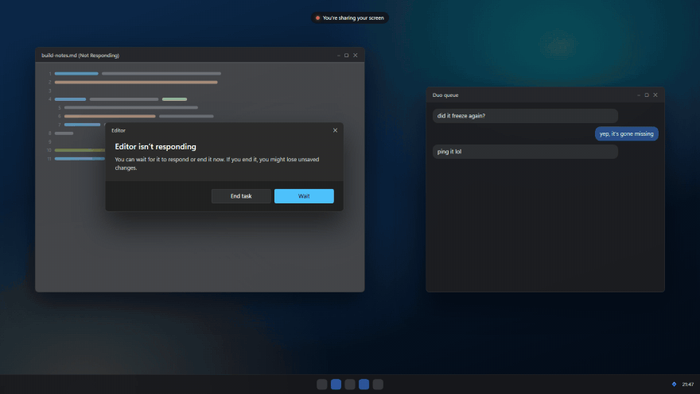

<h1 align="center"><br>lolPing AI</h1>

<p align="center">English | <a href="README.zh-CN.md">简体中文</a></p>

[](LICENSE)
[](https://github.com/0xAlchemist-cs/lolping-ai/actions/workflows/ci.yml)

League of Legends pings and emotes for your desktop, with an optional AI question card and Windows quick actions for websites, programs and screen clearing. The app still appears as **lolPing** in your tray and settings.

This fork is based on [darrenprx/lolPing](https://github.com/darrenprx/lolPing) v0.5.3, imported at [`efa3fe6`](https://github.com/darrenprx/lolPing/commit/efa3fe631863a9f89c924110b50c3766234dd0b9). Credit for the original application goes to its author, Danrui Meng.

## Requirements

| Platform | Requirements and scope |
| --- | --- |
| Windows | Windows 11 x64; quick actions and screenshot questions are implemented here. |
| macOS | Apple Silicon, macOS 13+, Accessibility permission; no Windows quick actions. |
| Linux | Experimental x64 X11 port, XInput 2.1/XTest and a compositor. No Wayland, including XWayland inside Wayland. See [Linux instructions](docs/linux.md). |

Building requires **Node.js 22.12+** and a C++20 toolchain: Visual Studio with Desktop development with C++ on Windows, Xcode Command Line Tools on macOS, or a C++ compiler and `libx11-dev libxi-dev libxtst-dev` on Linux. CI builds all three platforms; that does not establish manual acceptance on every desktop.

## Installation

Version **0.6.0** is being prepared for this fork. Until its installer appears on the [Releases page](https://github.com/0xAlchemist-cs/lolping-ai/releases), build from this repository to get its AI and quick-action features. The upstream project's installers are a different build.

```sh
git clone https://github.com/0xAlchemist-cs/lolping-ai.git
cd lolping-ai
npm ci
npx install-electron
```

On Windows, build both helpers in PowerShell. The compiler flags match the Windows CI test setup:

```powershell
$env:CL = '/utf-8 /Zc:preprocessor'
npm run build:helper
npm run build:desktop
```

On macOS or Linux, build only the input helper:

```sh
npm run build:helper
```

See [Packaging and checks](#packaging-and-checks) for installers and [Update channel](#update-channel) for update behavior.

## Configuration

Basic pings need no API key. After opening the app, use the tray icon to reach settings:

- **Trigger / Wheel:** choose the trigger and arrange the eight slices. The default ping trigger is Alt; the emote trigger is Ctrl.
- **Features → AI explain:** optional, off by default. Configure your service's HTTPS API base URL, model and API key.
- **Quick actions** on Windows: optional, off by default, with no presets. Save an action, enable its binding and turn on the overall switch.

Settings live in `%APPDATA%\lolPing\settings.json` on Windows, `~/Library/Application Support/lolPing/settings.json` on macOS, and the XDG configuration directory on Linux. API keys are encrypted separately in `ai-key.bin`, never stored as plaintext in `settings.json`. An unavailable encryption backend prevents saving a key.

## Quick start

```sh
npm run dev
```

On Windows, **hold Alt, press the left mouse button, drag to a slice and release the mouse button**. On macOS use Option instead of Alt and allow Accessibility for the application running development mode, such as Terminal.

| Action | Default control |
| --- | --- |
| Ping / emote wheel | Alt / Ctrl + left-button drag |
| Cancel a wheel | Release in the centre, right-click or Esc |
| Pause / resume | Ctrl + Alt + P |
| Room text / member panel | Alt + T / hold Tab, while in a room |
| Settings / quit | Click / right-click the tray icon; menu bar on macOS |

Trigger keys and mouse side buttons are configurable. Normal clicks do not run quick actions. On macOS, Control replaces Ctrl.

<p align="center"></p>

The animation shows the base wheel, not the AI or quick-action settings.

## Windows quick actions

In **Settings → Quick actions**, select an ordinary signal, configure its action and save. Any ordinary signal can run any supported action: for example, All In can clear the screen. The standard **Enemy Missing question mark is reserved for AI**, even when AI is off.

The wheel keeps its original Ping images and shows no action names. Moving a signal to another slice carries its saved action; directions do not determine action types.

| Type | Behavior |
| --- | --- |
| Website | Opens a valid HTTPS URL in the default browser. The browser decides how tabs are handled. |
| Program | Choose a local `.exe` through the system picker. Restore and request the foremost eligible window with the exact executable path; if none exists, open the executable again. A refused activation stops without launching another instance. |
| Clear screen | Requests Windows to minimize desktop windows. Repeating only minimizes; it never restores windows. |

The Ping and sound still happen, followed immediately by the action request. Only a local wheel release can run it: previews, trigger-plus-click Pings and room members' Pings cannot.

Edits take effect on **Save**. **Test saved action** runs only a saved, enabled binding and works even with the overall switch off. Removing or disabling a binding keeps the original Ping behavior.

Tray apps and launchers may reopen as another instance. Games may require their launcher rather than the game's executable. Windows can require a manual administrator prompt; lolPing does not automatically elevate. Free-form arguments, scripts, shortcuts, files and folders are unsupported.

## AI explain (experimental)

This fork adds an AI question window. Turn it on under **Settings → Features**, place an Enemy Missing ping with the wheel, and a small card opens where you type a question and the answer streams in. Everything about the ping itself — the wheel, the art, the sound, room sharing — is unchanged, and the feature is off by default.

You bring the service: fill in an **API base URL**, a **model name** and an **API key** for an OpenAI-compatible chat completions endpoint. Your questions and answers go to that service and nowhere else, and usage may cost money on that service’s plan. The key is encrypted with your system’s credential protection (safeStorage; DPAPI on Windows) and stored next to the settings — never in `settings.json`, never shown again, and **Remove key** forgets it. Packaged builds accept only HTTPS endpoints; loopback, private and local addresses are refused.

On Windows, **Local screenshot preview** shows the original ping area and monitor context locally. The original **Ask** button sends text only. To ask about an image, review the preview and click **Send selected screenshots and ask**: one local crop is selected by default; including the full monitor requires checking its box. The card names the recipient domain and model. Only the selected JPEGs leave the machine, going to your configured third-party AI service; check them for personal information first and use a model that supports images. Closing or expiring a preview invalidates its temporary in-memory upload snapshot. Image retry requires a fresh preview and confirmation; it never uploads automatically.

Drag the card's title bar to move it, drag its edges to resize it, or double-click the title to expand and restore it. Wider windows show the two previews side by side. Image scrolling is separate from the question and send controls.

## Pings, emotes and rooms

- Arrange both wheels, set size/sound, or keep the latest Ping until the next one. Full-screen capture includes overlays; sharing a single application window does not.
- Import up to 24 PNG, JPG, GIF or WebP emotes. Friends receive a still image; custom animations and sounds stay local. The setting to show friends' custom emotes controls sending and fetching them.
- Create a room in **Settings → Room**, share its code, and let friends join. Rooms use the LAN and, when allowed, public Nostr relays. A room holds up to 16 people.
- Room text, surrender/ready/kick votes and the member panel retain their existing behavior. A held Tab and Alt + T are reserved while in a room; change or disable those features if they conflict. Kick votes are best effort, not a persistent ban.

## Privacy and network use

- AI requests go to your configured service; image upload requires the explicit image-send action described above.
- Action names, website destinations and executable paths stay local rather than travelling in room messages. Website actions hand the URL to your browser; lolPing does not fetch website icons.
- Room content is encrypted using a key derived from the room code. LAN peers can see your local IP; public relays see your IP, room identifier and traffic timing. Disable internet room connections for LAN-only use.
- Update checks contact GitHub. Automatic checks are enabled by default in packaged Windows/macOS builds; the switch controls the schedule, not the destination of a manual update.

## Update channel

**Starting with this 0.6.0 build, Windows and macOS check this fork's releases.** The Windows provider, packaged update metadata and macOS release API all use `0xAlchemist-cs/lolping-ai`. Merging code alone does not publish an installer; a matching public release and its update files must exist before an update can be offered.

Older 0.5.3 fork builds still check upstream. Install a build from this repository to change that channel. Automatic checks can be disabled under **Settings → App**; manual checks remain available. Development-server and localhost-update environment overrides are ignored by installed builds.

The updater checks 10 seconds after startup and every six hours, downloads only after a click, and verifies the download before installation. Linux updates are manual. Windows login-start registration is reconciled with the installed executable, while a startup entry disabled in Windows stays disabled until explicitly enabled in settings.

## Delivery status and remaining checks

On **2026-10-26**, [PR #6](https://github.com/0xAlchemist-cs/lolping-ai/pull/6) merged the Windows actions into `main`; [the merged commit's CI](https://github.com/0xAlchemist-cs/lolping-ai/actions/runs/40342806222) passed on Windows, macOS and Linux. The user confirmed repeated clearing through the real Alt wheel, reopening windows between attempts. The original wheel images remain.

The real Windows 0.5.3-to-0.6.0 installer upgrade preserved settings and the encrypted key, updated the desktop shortcut and registered login start. On 2026-10-27 the user confirmed the installed build passed single-screen 100%, 150% and 200% checks for wheel placement/selection, website/program actions, repeated clearing, local screenshot alignment and cancellation. The user also confirmed Alt wheel, website actions and clearing worked after locking and unlocking Windows. Remaining acceptance includes mixed DPI and multiple monitors, monitor changes, other physical trigger/side-button combinations, actual login, UAC secure-desktop return, elevated/tray/launcher windows, long-running stability and physical-input latency. See the current [release-readiness record](docs/release-readiness.md) for evidence and open checks.

Windows can refuse foreground activation, fullscreen protection does not recognize windowed games, and Linux has no automatic fullscreen detection. macOS Accessibility and unsigned-package behavior need real-machine checks. Moving an unpacked build can also leave shortcuts or login-start entries pointing at an older location; verify them when changing its location.

See the [acceptance record](docs/p3-acceptance.md) and [performance measurements](docs/p3-performance-verification.md). They include earlier pending-merge and ToggleDesktop checkpoints; the current desktop action is one-way clearing.

## Packaging and checks

Run packaging on the target operating system; outputs go under `release/`.

| Command | Output / purpose |
| --- | --- |
| `npm run dist` | Windows installer and unpacked app; builds both helpers |
| `npm run dist:mac` | Apple Silicon disk image |
| `npm run dist:linux` | AppImage and Debian package |
| `npm run dev:site` | Browser wheel demo; no desktop actions |

```sh
npm run typecheck
npm run test:helper
npm test
npm run build
npm run build:site
```

On Windows, also run `npm run test:desktop` and `node tools/verify-desktop-package.cjs release/win-unpacked/resources`. Desktop tests can minimize windows; run them on an idle desktop. Strict native-effect acceptance sets `$env:LOLPING_DESKTOP_EFFECT_STRICT = '1'` before `npm run test:desktop`: replies without visible fixture effects then fail rather than pass.

The tag-triggered [Release workflow](.github/workflows/release.yml) waits for Windows, macOS and Linux packages before publishing. Windows also checks both native helpers and packaged resources. CI success does not prove that a public release or physical acceptance has happened. Local Windows installers are unsigned.

## Documentation and contributing

- [Design and architecture](docs/design.md), [macOS design](docs/design-macos.md), [Linux build and limitations](docs/linux.md).
- [Input verification](docs/p3-input-verification.md), [full-app verification](docs/p3-full-app-verification.md), [program boundaries](docs/p3-program-verification.md), [packaging verification](docs/p3-packaging-verification.md).
- Read [AGENTS.md](AGENTS.md), use Conventional Commits and the PR template, and keep changes focused. Report fork issues in [this repository](https://github.com/0xAlchemist-cs/lolping-ai/issues).

## License

The code is under the [MIT license](LICENSE). The ping and emote icons, animations and sounds are © Riot Games and aren't covered by it. If you represent Riot Games and want something removed, please open an issue.

lolPing isn't endorsed by Riot Games and doesn't reflect the views or opinions of Riot Games or anyone officially involved in producing or managing Riot Games properties. Riot Games, and all associated properties are trademarks or registered trademarks of Riot Games, Inc.
