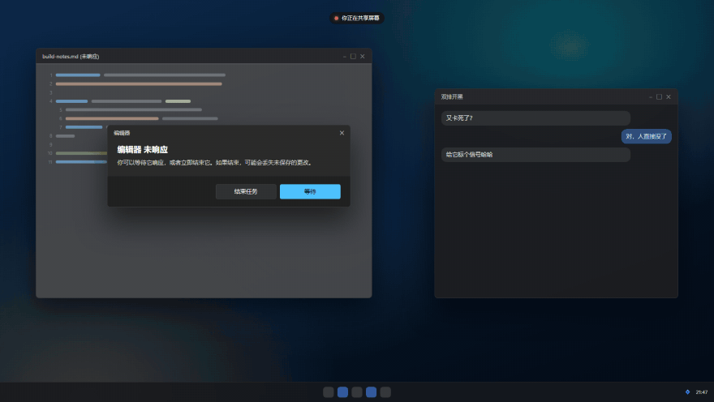

<h1 align="center"><br>lolPing AI</h1>

<p align="center"><a href="README.md">English</a> | 简体中文</p>

[](LICENSE)
[](https://github.com/0xAlchemist-cs/lolping-ai/actions/workflows/ci.yml)

把英雄联盟信号和表情带到桌面，并提供可选的 AI 提问卡片，以及打开网页、打开软件、一键清屏的 Windows 快捷动作。托盘和设置中的应用名称仍为 **lolPing**。

本仓库派生自 [darrenprx/lolPing](https://github.com/darrenprx/lolPing) v0.5.3，导入基线为 [`efa3fe6`](https://github.com/darrenprx/lolPing/commit/efa3fe631863a9f89c924110b50c3766234dd0b9)。原应用由 Danrui Meng 开发。

## 环境要求

| 平台 | 要求与范围 |
| --- | --- |
| Windows | Windows 11 x64；快捷动作和截图提问在此平台实现。 |
| macOS | Apple 芯片、macOS 13+，需要辅助功能权限；没有 Windows 快捷动作。 |
| Linux | 实验性的 x64 X11 版本，需要 XInput 2.1/XTest 和合成器。不支持 Wayland，包括 Wayland 中的 XWayland。详见 [Linux 说明](docs/linux.md)。 |

源码构建需要 **Node.js 22.12+** 和 C++20 工具链：Windows 使用带“使用 C++ 的桌面开发”组件的 Visual Studio，macOS 使用 Xcode Command Line Tools，Linux 使用 C++ 编译器及 `libx11-dev libxi-dev libxtst-dev`。三平台都有 CI 构建，不能据此认定所有真实桌面环境都已验收。

## 安装

本派生版正在准备 **0.6.0**。安装包出现在[发布页面](https://github.com/0xAlchemist-cs/lolping-ai/releases)之前，请从本仓库源码构建以使用这里的 AI 和快捷动作；上游安装包是另一个构建版本。

```sh
git clone https://github.com/0xAlchemist-cs/lolping-ai.git
cd lolping-ai
npm ci
npx install-electron
```

Windows 在 PowerShell 中构建两个 Helper，编译选项与 Windows CI 测试配置一致：

```powershell
$env:CL = '/utf-8 /Zc:preprocessor'
npm run build:helper
npm run build:desktop
```

macOS 和 Linux 只构建输入 Helper：

```sh
npm run build:helper
```

生成安装包见[打包与检查](#打包与检查)，更新行为见[更新渠道](#更新渠道)。

## 配置

基础信号不需要 API 密钥。首次打开后，通过托盘图标进入设置：

- **触发 / 轮盘：** 选择触发方式，调整八个扇区。信号默认使用 Alt，表情默认使用 Ctrl。
- **功能 → AI 解释：** 可选，默认关闭。填写自己的服务 HTTPS API 地址、模型名称和 API 密钥。
- Windows 的**快捷动作：** 可选，默认关闭、没有预设动作。保存动作、启用该绑定，再打开总开关。

Windows 设置文件位于 `%APPDATA%\lolPing\settings.json`，macOS 位于 `~/Library/Application Support/lolPing/settings.json`，Linux 位于 XDG 配置目录。API 密钥单独加密保存在 `ai-key.bin`，不以明文写入 `settings.json`；系统加密能力不可用时，应用会拒绝保存密钥。

## 快速开始

```sh
npm run dev
```

Windows 操作是：**按住 Alt，按下鼠标左键，拖到扇区后松开鼠标**。macOS 使用 Option，并为运行开发版的程序（例如终端）授予辅助功能权限。

| 操作 | 默认方式 |
| --- | --- |
| 信号 / 表情轮盘 | Alt / Ctrl＋左键拖动 |
| 取消轮盘 | 在中心松开、右键或 Esc |
| 暂停 / 恢复 | Ctrl＋Alt＋P |
| 房间文字 / 成员面板 | 在房间中 Alt＋T / 按住 Tab |
| 设置 / 退出 | 单击 / 右键托盘图标；macOS 使用菜单栏 |

触发键和鼠标侧键可在设置中调整。普通单击不会执行快捷动作。macOS 对应使用 Control 键。

<p align="center"></p>

动图展示基础轮盘，不展示 AI 或快捷动作设置。

## Windows 快捷动作

在**设置 → 快捷动作**中选择普通信号，配置动作并保存。普通信号可以执行任意支持的动作，例如“全力进攻”也能配置为清屏。标准的**“敌人消失”问号固定给 AI**，关闭 AI 后也不用于普通动作。

轮盘保留原来的 Ping 图标，不显示动作名称。信号换到其他扇区时，其已保存的动作随之移动；方向不限定动作类型。

| 类型 | 行为 |
| --- | --- |
| 打开网页 | 使用默认浏览器打开合法的 HTTPS 地址；标签页行为由浏览器决定。 |
| 打开软件 | 通过系统文件选择器选择本地 `.exe`。按程序完整路径寻找匹配的普通窗口，还原并请求切换到最靠前的窗口；没有合适窗口才再次打开程序。切换被拒绝时停止，不再启动一个实例。 |
| 一键清屏 | 请求 Windows 最小化桌面窗口。重复触发仍只最小化，不恢复窗口。 |

照常发出 Ping 和声音后，立即调度动作。只有本机轮盘松开确认会触发；设置预览、触发键加单击、房间成员的 Ping 都不会触发。

编辑后点击**保存**才生效。**测试已保存动作**只执行已经保存且启用的绑定，总开关关闭时也可显式测试。移除或禁用绑定后保留原有 Ping 行为。

托盘程序和启动器再次打开时可能多开；游戏可能必须选择启动器而非游戏内部的可执行文件。Windows 可能要求用户手动确认管理员提示，lolPing 不自动提权。首版不支持自由参数、脚本、快捷方式、普通文件和文件夹。

## AI 解释（实验性）

本派生版本增加了 AI 提问窗口：在 **设置 → 功能** 中开启后，用轮盘打出「敌人消失」问号，就会弹出一个提问卡片，输入问题后回答会逐步流式显示。信号本身——轮盘、动画、音效、房间共享——完全不变，且该功能默认关闭。

服务由你自己提供：填写一个 OpenAI 兼容 chat completions 服务的 **API 地址**、**模型名称** 和 **API 密钥**。问题与回答只会发送到你配置的这一处服务，并可能在该服务产生费用。密钥使用系统凭据保护（safeStorage；Windows 上为 DPAPI）加密保存，与设置文件放在同一目录——绝不写入 `settings.json`，不会再次显示，点 **删除密钥** 即可忘掉。正式包仅接受 HTTPS 地址；环回、私有和本地网段一律拒绝。

Windows 上的「本地截图预览」只在本机显示原始问号附近的截图和显示器上下文。原来的「提问」按钮只发送文字。识图时，先检查预览，再点「发送所选截图并提问」：默认只选局部图，完整显示器必须主动勾选。卡片会显示接收域名和模型。只有选中的 JPEG 会离开本机，发送到你配置的第三方 AI 服务；请先检查个人信息，并使用支持图像的模型。关闭预览或快照过期后，临时内存快照即失效。图片重试需要重新预览和确认，不会自动上传。

拖动卡片标题栏可移动，拖动边角可缩放，双击标题栏可放大和恢复。宽窗口下两张预览并排显示，图片可独立滚动，问题输入和发送操作保持可达。

## 信号、表情与房间

- 调整两个轮盘及尺寸、音量，或让最后一个信号保留到下次发出。共享整个屏幕能包含叠加内容，单窗口共享不会包含。
- 最多导入 24 张 PNG、JPG、GIF 或 WebP 表情。好友收到静态图，自定义动画和声音留在本机；“显示好友的自定义表情”控制发送和获取。
- 在**设置 → 房间**创建房间、分享房间码，好友即可加入。支持局域网，以及开启互联网连接后的公共 Nostr 中继；最多 16 人。
- 房间文字、投降 / 准备 / 踢人投票和成员面板沿用原有行为。在房间内，按住 Tab 和 Alt＋T 会由房间功能使用；有冲突时可换键或关闭对应功能。踢人投票不等于永久封禁。

## 隐私与网络

- AI 请求发送到你配置的服务；图片上传需要明确点击上文的发送图片操作。
- 动作名称、网页目标和程序路径保存在本机，不通过房间消息发送。网页动作把网址交给浏览器，lolPing 不抓取网站图标。
- 房间内容使用由房间码派生的密钥加密。局域网成员可看到本地 IP；公共中继可看到 IP、房间标识和收发时间。关闭互联网房间连接即可只使用局域网。
- 更新检查会访问 GitHub。打包后的 Windows / macOS 版本默认开启自动检查；这个设置控制检查时间，不改变手动更新的目标渠道。

## 更新渠道

**从当前 0.6.0 构建开始，Windows 和 macOS 检查本派生版的发布。** Windows 更新器、打包元数据和 macOS 发布 API 均使用 `0xAlchemist-cs/lolping-ai`。代码合并不会自动发布安装包；对应的公开 Release 和更新文件就绪后，应用才能提供更新。

旧的 0.5.3 派生版仍然检查上游，需要安装本仓库的新构建才能切换渠道。可在**设置 → 应用**关闭自动检查，手动检查仍可使用。安装版会忽略开发服务器和本地更新测试环境变量。

更新器在启动 10 秒后及之后每六小时检查，用户点击后才下载，校验通过后再安装；Linux 手动更新。Windows 会将登录启动项同步到安装后的程序路径；在系统中禁用的启动项会保持禁用，直到用户在设置中明确重新启用。

## 交付状态与待验收项

**2026-10-26**，[PR #6](https://github.com/0xAlchemist-cs/lolping-ai/pull/6) 已把 Windows 快捷动作合并到 `main`，[合并提交的 CI](https://github.com/0xAlchemist-cs/lolping-ai/actions/runs/40342806222) 在 Windows、macOS 和 Linux 全部通过。用户也在本机真实 Alt 轮盘中反复清屏，重新打开窗口后再测试，确认每次成功；轮盘保留原图标。

真实的 Windows 0.5.3 → 0.6.0 安装升级已验证：设置和加密密钥保留，桌面快捷方式更新，自启动项已登记。2026-10-27，用户确认安装版在单屏 100%、150%、200% 下的轮盘位置与选择、网页和软件动作、重复清屏、本地截图对齐及取消操作均通过。用户另行确认，Windows 锁屏解锁后 Alt 轮盘、网页动作和清屏均正常。剩余验收包括混合 DPI、多显示器及显示模式变化、其他实体触发键和鼠标侧键组合、实际登录启动、提权 / 托盘 / 启动器窗口、长时间运行稳定性，以及物理输入端到端延迟。当前证据与待测项见[发布就绪记录](docs/release-readiness.md)。

Windows 可能拒绝切到前台，现有全屏保护不能识别窗口化游戏；Linux 没有自动全屏检测。macOS 的辅助功能和未签名安装体验仍需真机验证。移动未安装版目录，也可能让快捷方式或登录启动项仍指向旧位置，变更位置后应单独核对。

详细证据见[验收记录](docs/p3-acceptance.md)和[性能测量](docs/p3-performance-verification.md)。这些文件包含早期“待合并”和 ToggleDesktop 阶段记录；当前清屏为单向最小化。

## 打包与检查

在目标操作系统上运行打包命令，产物位于 `release/`。

| 命令 | 产物 / 用途 |
| --- | --- |
| `npm run dist` | Windows 安装包和未安装目录；会构建两个 Helper |
| `npm run dist:mac` | Apple 芯片磁盘映像 |
| `npm run dist:linux` | AppImage 和 Debian 包 |
| `npm run dev:site` | 浏览器轮盘演示，不执行桌面动作 |

```sh
npm run typecheck
npm run test:helper
npm test
npm run build
npm run build:site
```

Windows 还应运行 `npm run test:desktop` 和 `node tools/verify-desktop-package.cjs release/win-unpacked/resources`。桌面测试可能最小化窗口，应在空闲桌面执行。原生效果严格验收是在 `npm run test:desktop` 前设置 `$env:LOLPING_DESKTOP_EFFECT_STRICT = '1'`，让“返回成功但测试窗口未变化”成为失败。

按标签触发的 [Release 工作流](.github/workflows/release.yml) 会等 Windows、macOS、Linux 产物全部就绪后再发布；Windows 额外检查两个原生 Helper 和打包资源。CI 成功不代表已公开发布或完成人工验收。本地 Windows 安装包尚未签名。

## 文档与参与开发

- [设计与架构](docs/design.md)、[macOS 设计](docs/design-macos.md)、[Linux 构建与限制](docs/linux.md)。
- [输入验收](docs/p3-input-verification.md)、[完整应用验证](docs/p3-full-app-verification.md)、[程序目标边界](docs/p3-program-verification.md)、[打包验证](docs/p3-packaging-verification.md)。
- 阅读 [AGENTS.md](AGENTS.md)，遵循 Conventional Commits 和 PR 模板，保持每次改动范围集中。派生版的问题请向[本仓库](https://github.com/0xAlchemist-cs/lolping-ai/issues)反馈。

## 许可证

代码采用 [MIT 许可证](LICENSE)。信号和表情的图标、动画与音效版权归 Riot Games 所有，不在该许可证范围内。如果你代表 Riot Games 并希望移除相关内容，请提交 issue。

lolPing isn't endorsed by Riot Games and doesn't reflect the views or opinions of Riot Games or anyone officially involved in producing or managing Riot Games properties. Riot Games, and all associated properties are trademarks or registered trademarks of Riot Games, Inc.
